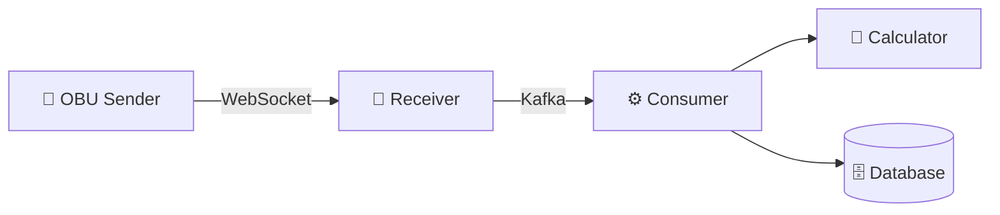
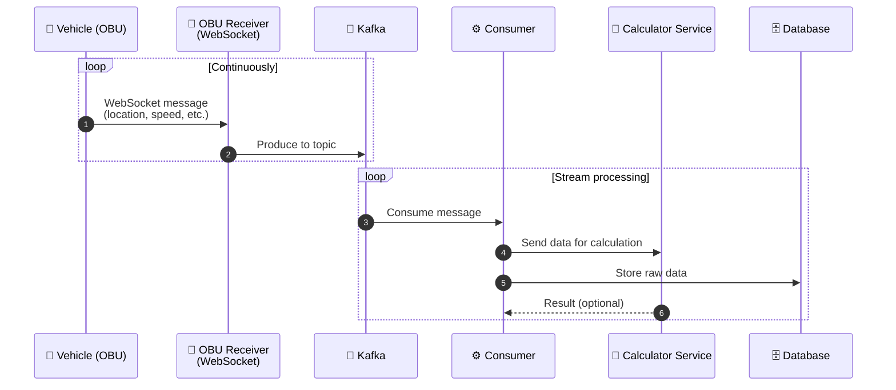

# On-Board-Unit-OBU-microservice
a vehicle-installed electronic device that collects and transmits travel, location, and vehicle data to central servers or roadside infrastructure. It is most commonly used in commercial trucking for automatic electronic toll collection and fleet telematics.

